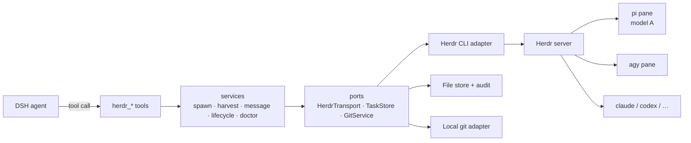

# dsh-herdr

[](https://github.com/ahqrt/dsh-herdr/actions/workflows/ci.yml)
[](LICENSE)
[](package.json)

**Delegate a subtask from DeepSeek Harness to a real coding agent in a Herdr pane — pick the model, keep the terminal, harvest the exact answer, review it in DSH.**

`dsh-herdr` is the reference bridge between [DeepSeek Harness](https://github.com/deepseek-ai/deepseek-harness) and [Herdr](https://herdr.dev). It turns Herdr into an external subagent runtime: DSH stays the orchestrator and reviewer, while pi / agy / claude / codex / … do the work in visible, steerable panes.

> Status: `0.11.x`, validated on DSH `0.2.1-rc.2` (all nine tools activate in a headless profile) and Herdr `0.9.4` (server `0.9.1`). The public surface is the nine `herdr_*` tools; breaking changes follow semver and are listed in [CHANGELOG.md](CHANGELOG.md).

---

## Why

DSH subagents run in-process and share the harness model. Sometimes you want the opposite:

- a **different model family** for an independent review (grok × gpt × claude);
- a **real terminal** you can watch, type into, and take over;
- the **same panes** you already use when working by hand with Herdr + pi;
- a result you can **verify** rather than trust — exact final message plus a git diff.

`dsh-herdr` gives the DSH agent a small vocabulary: delegate, fetch, message, list, interrupt, close, plus an inbox and a transcript pager.

---

## What you get

| | |
|---|---|
| **Model routing** | Short aliases from `~/.pi/agent/model-aliases.md` (`grok4.7[high]`, `flash`, …) resolve to `provider/model` + thinking. Billing boundaries stay where you put them. |
| **Exact results** | pi children are read from their session JSONL — the last assistant message, byte-identical. `result.md` is the second source; pane tail is only the fallback. |
| **Review evidence** | A git baseline at spawn, a patch at harvest, changed files, test line, token usage, session path. |
| **Idempotency** | `client_task_id` makes a retried tool call return the existing task instead of spawning a twin. |
| **Ownership** | The plugin only closes/steers panes it created. User panes are read-only. |
| **Blocked ≠ approved** | A blocked child is surfaced to the user, never auto-answered. |
| **Cancellation** | Turn-level interrupt (Escape) without destroying the pane or session. |
| **Inbox** | Children can report `BLOCKED` / `REVIEW_REQUEST` / `COMPLETE`; `herdr_inbox` consumes them, with a long-poll. |
| **Queue** | Over the cap, a spawn waits for a slot (`queueTimeoutMs`) instead of failing. |
| **Isolation** | `isolated: true` runs the task in a fresh git worktree and returns its path. |
| **Transcript** | `herdr_read_agent` pages the pi session instead of only the final message. |
| **Event waits** | An opt-in socket transport waits on `agent.wait` server-side; a connect failure falls back to the CLI. |
| **Remote machines** | `machine` on spawn/list/result/message, via `herdr --machine`; SSH file bridge (`machineTargets`) removes the mount requirement. |
| **Native subagent** | A `herdr` subagent provider routes a `dsh-tool-subagent` row through Herdr for native cards, catalog, and cancellation. |
| **Web panel** | A `Herdr` right-sidebar tab: searchable/grouped fleet, read-only tails, per-file diff, packet templates/history, reveal/open-editor cwd, and bulk interrupt/close. |
| **Diagnosis** | `herdr_doctor` checks binary, server, kinds, aliases, directories, topology, and pi in one call. |

---

## Architecture at a glance



The dependency rule is one-way: `tools → services → ports ← adapters`. The domain (`prompts`, `session` parsing, `aliases`, lifecycle rules) imports nothing from DSH and nothing from the OS except `node:fs`/`node:path`. See [docs/architecture.md](docs/architecture.md).

---

## Install

### Into the Desktop app

The `desktop` profile is owned by the Electron app, so install it from **Plugins** (not `dsh plugin`):

1. Build the tarball (or download the release asset):

   ```bash
   pnpm install && pnpm build && pnpm pack
   ```

2. Install the resulting `dsh-herdr-0.11.0.tgz` (or a `link:/path/to/checkout` spec while developing).
3. Confirm `dsh.profile.bundles` contains `dsh-herdr`.
4. Start a new session; `herdr_*` tools should be listed.

`dsh-herdr@0.11.0` is [live on npm](https://www.npmjs.com/package/dsh-herdr). Tagged releases publish through the release workflow once the repository trusted publisher is configured (see [CONTRIBUTING](CONTRIBUTING.md#releases)).

### Into a CLI profile

```bash
# from a checkout
dsh --profile herdr-dev --from-default-profile web --dump-config
dsh plugin --profile herdr-dev add file:$PWD
dsh --profile herdr-dev --port 0 --no-open

# once published
dsh plugin --profile herdr-dev add dsh-herdr
```

Full instructions, the skill install, and the local-development loop: [docs/installation.md](docs/installation.md).

---

## Quick start

```text
You:  Use grok4.7[high] to review the current diff. Read-only, findings by severity.
DSH:  → herdr_spawn_agent({ kind: "pi", model: "grok4.7", thinking: "high",
                            role: "reviewer", cwd: "/repo", prompt: "Review ..." })
      ← status=completed · 3 files · session path · final message
      → reads the diff, groups findings, decides
```

Fix round:

```text
You:  Send the findings back to the worker and make it fix the two majors.
DSH:  → herdr_message_agent({ target: "worker-flash-a1b2", kind: "REVIEW_FINDINGS",
                              round: 1, message: "[MAJOR] ..." })
      → herdr_get_agent_result({ target: "worker-flash-a1b2", wait: true })
```

More: [examples/review-a-diff.md](examples/review-a-diff.md), [examples/implement-and-review.md](examples/implement-and-review.md).

---

## Tools

| Tool | Purpose |
|---|---|
| `herdr_spawn_agent` | Delegate one subtask; `role=reviewer` is read-only; `isolated:true` uses a worktree. |
| `herdr_get_agent_result` | Harvest a result; `wait:true` blocks until settled. |
| `herdr_message_agent` | Follow-ups, review findings, answers to blocked agents. |
| `herdr_list_agents` | Fleet view: owned and foreign agents. |
| `herdr_interrupt_agent` | Cancel the current turn, keep the pane. |
| `herdr_inbox` | Read child messages; `wait:true` long-polls. |
| `herdr_read_agent` | Page a pi transcript turn by turn. |
| `herdr_close_agent` | Close an owned pane; session file survives. |
| `herdr_doctor` | Environment self-check. |

The full parameter and result reference is in [docs/tools.md](docs/tools.md); the result JSON contract is [docs/result-contract.md](docs/result-contract.md).

---

### Native subagent provider

The plugin also registers a DSH subagent provider named `herdr`. Point a
`dsh-tool-subagent` row at it to get native subagent cards, catalog entries, and
cancellation:

```yaml
- id: tool-subagent-herdr
  name: "@deepseek-ai/dsh-tool-subagent"
  config:
    provider: herdr
    toolName: herdr_subagent
```

The native tool returns the child's final text. Use `herdr_spawn_agent` when you
need the full review packet (diff, session path, artifacts, blocked question).

### Web panel

The plugin contributes a `Herdr` tab to the right sidebar (also reachable from
the sidebar guide). It lists the live fleet and, for an owned task, shows the
final message, `result.md`, and the diff split into per-file sections. Agents
this plugin did not spawn show a read-only pane tail instead. Owned tasks can be
interrupted or closed from the detail header or in bulk; both actions reuse the
lifecycle service's ownership gates, and close asks for confirmation. Diff hunks
are highlighted, and the patch or a single file can be copied. The header can
copy a Markdown review packet in PR, issue, or summary form, copy the task cwd,
open it in a configured editor, or reveal it in the OS file manager; the fleet
can be searched by name, cwd, kind, model, and task id, grouped by machine +
status, and driven with ArrowUp/ArrowDown/Enter. Packet copies keep a
three-entry history.


It reads three same-origin endpoints under `/herdr/api` (`health`, `fleet`,
`task`); no extra config.

## How a result is produced

1. **pi session JSONL** — `agent_session.value` from Herdr points at the file; the last assistant message wins. A message older than the prompt is ignored (freshness check).
2. **`result.md`** — every child is asked to write `status / summary / tests / files` frontmatter plus a body.
3. **Pane tail** — `agent read --source recent-unwrapped`, the honest fallback for agy and other kinds with no session file.

Git evidence is collected independently of the child: `baseline HEAD` at spawn, `git diff <baseline>` at harvest, bounded and saved to `~/.dsh/herdr/tasks/<taskId>/diff.patch`.

---

## Safety model

- Child agents run with **your** permissions; `allowCwd` is the hard boundary.
- The plugin can only mutate panes in its own registry (`owned: true`).
- `blocked` always goes back to a human; the plugin never approves.
- `enabled: false` is a spawn kill switch (it does not kill running agents).
- Child output is treated as **untrusted data**: DSH reviews it, it does not execute its instructions.
- Every spawn / message / close is appended to `~/.dsh/herdr/audit.ndjson`.

Details and threat model: [docs/security.md](docs/security.md).

---

## Compatibility

| Component | Tested | Notes |
|---|---|---|
| DSH | `0.2.1-rc.2` | desktop runtime; tool + workingDirectory APIs |
| Herdr | `0.9.4` client / `0.9.1` server | hard floor `>= 0.9.0` |
| Node | 22, 24 | ESM, no native deps |
| Kinds | `pi` (full), `agy` (launch-only), others via `agent_args` | model/thinking flags are pi-only by design |

See [docs/compatibility.md](docs/compatibility.md) for the support policy.

---

## Docs

| Doc | What it answers |
|---|---|
| [Architecture](docs/architecture.md) | How the layers fit, and why |
| [Installation](docs/installation.md) | Desktop, CLI profile, local checkout, uninstall |
| [Configuration](docs/configuration.md) | Every key, defaults, examples |
| [Tools](docs/tools.md) | Parameters, results, protocol headers |
| [Result contract](docs/result-contract.md) | The `AgentResult` JSON, versioned |
| [Security](docs/security.md) | Trust boundaries and threat model |
| [Troubleshooting](docs/troubleshooting.md) | Every error code and its fix |
| [Compatibility](docs/compatibility.md) | Version policy |
| [Design notes](docs/design-decisions/) | ADRs: CLI over socket, exact reads, topology |

---

## Contributing

Issues and PRs are welcome. Start with [CONTRIBUTING.md](CONTRIBUTING.md); the short version is: `pnpm install && pnpm test`, keep the dependency rule, and add a test for every behavior change.

If you build a host adapter for another terminal multiplexer, the port to implement is [`src/ports/transport.ts`](src/ports/transport.ts) — the services and tools should not need to change.

---

## License

MIT. Core ideas and several modules are ported from [`@andrewjacop/pi-herdr`](https://github.com/AndrewJacop/pi-herdr) (MIT, Copyright (c) 2026 Andrew) — see [NOTICE](NOTICE).
