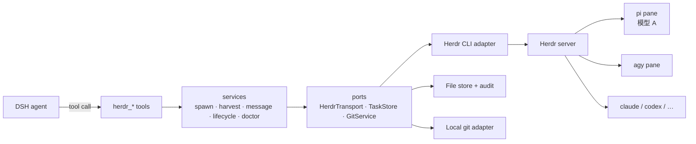

# dsh-herdr

[](https://github.com/ahqrt/dsh-herdr/actions/workflows/ci.yml)
[](LICENSE)
[](package.json)

**从 DeepSeek Harness 把子任务派给 Herdr pane 里真实的 coding agent：指定模型、保留终端、拿回逐字结果、在 DSH 里 review。**

`dsh-herdr` 是 DeepSeek Harness 与 [Herdr](https://herdr.dev) 之间的参考桥接。它把 Herdr 当成外部子代理运行时：DSH 负责编排和验收，pi / agy / claude / codex 在你看得见、能接管的 pane 里干活。

> 状态：`0.3.x`，已在 DSH `0.2.1-rc.2` 上验证（headless profile 中 9 个工具全部激活），实测 Herdr `0.9.4`（server `0.9.1`）。公共接口就是 9 个 `herdr_*` 工具；破坏性变更遵循 semver，并记录在 [CHANGELOG.md](CHANGELOG.md)。

---

## 为什么需要它

DSH 自带 subagent 跑在进程内，和主会话共用模型。有些场景你要的是反面：

- 用**另一个模型家族**做独立 review（grok × gpt × claude）；
- 一个**真实终端**，能看、能输入、能随时接管；
- 复用你手工开发时已经开着的 Herdr + pi pane；
- 一个**可验证**的结果，而不是一句“我做完了”：逐字最终答复 + git diff。

`dsh-herdr` 给 DSH agent 六个动作：派活、取结果、发消息、看舰队、中断、关闭。

---

## 能力

| | |
|---|---|
| **模型路由** | 直接读 `~/.pi/agent/model-aliases.md`，`grok4.7[high]`、`flash` 解析成 `provider/model` + thinking。计费边界留在你写的地方。 |
| **精确结果** | pi 子 agent 从 session JSONL 读最后一条 assistant 消息，逐字；`result.md` 是第二来源；pane 尾部只做兜底。 |
| **Review 证据** | spawn 时记 git baseline，harvest 时生成 patch、改动文件、测试行、token 用量、session 路径。 |
| **幂等** | `client_task_id` 让重试的工具调用返回已有任务，不会起第二个 pane。 |
| **归属** | 插件只关闭/操作自己创建的 pane；用户自己开的 pane 只读。 |
| **Blocked 不代答** | 子 agent 等审批时交给用户，插件绝不自动批准。 |
| **可取消** | 发 Escape 中断当前 turn，pane 和 session 都保留。 |
| **Inbox** | 子 agent 可以回报 `BLOCKED` / `REVIEW_REQUEST` / `COMPLETE`，`herdr_inbox` 消费，支持长轮询。 |
| **队列** | 超过并发上限时等待空位（`queueTimeoutMs`），不是立刻失败。 |
| **隔离** | `isolated: true` 在独立 git worktree 里跑，返回路径。 |
| **Transcript** | `herdr_read_agent` 按 turn 翻 pi session，不只看最终答复。 |
| **事件等待** | 可选 socket 传输，用 `agent.wait` 在服务端等；连接失败自动退回 CLI。 |
| **远程机器** | spawn/list/result/message 支持 `machine`，走 `herdr --machine`；远程 spawn 需要共享文件系统，远程查看不需要。 |
| **可诊断** | `herdr_doctor` 一次检查 binary、server、kinds、别名表、目录、拓扑、pi。 |

---

## 架构



依赖只有一个方向：`tools → services → ports ← adapters`。domain 层（任务信封、session 解析、别名、生命周期规则）不 import DSH，也不碰 OS（除了 `node:fs` / `node:path`）。细节见 [docs/architecture.md](docs/architecture.md)。

---

## 安装

### 装进 Desktop 应用

`desktop` profile 由 Electron 独占，不能 `dsh plugin`，要走应用内 **Plugins** 页：

1. 先打包（或下载 release 附件）：

   ```bash
   pnpm install && pnpm build && pnpm pack
   ```

2. 在 Plugins 页安装生成的 `dsh-herdr-0.3.1.tgz`（开发期也可以用 `link:/path/to/checkout`）。
3. 确认 `dsh.profile.bundles` 里出现 `dsh-herdr`。
4. 新建会话，工具列表里应出现 `herdr_*`。

`dsh-herdr@0.3.1` 已[发布到 npm](https://www.npmjs.com/package/dsh-herdr)。配好仓库的 trusted publisher 后，每个 tag 由 release workflow 自动发布（见 [CONTRIBUTING](CONTRIBUTING.md#releases)）。

### 装进 CLI profile

```bash
# 从 checkout
dsh --profile herdr-dev --from-default-profile web --dump-config
dsh plugin --profile herdr-dev add file:$PWD
dsh --profile herdr-dev --port 0 --no-open

# npm 发布后
dsh plugin --profile herdr-dev add dsh-herdr
```

完整步骤和本地开发回路：[docs/installation.md](docs/installation.md)。

---

## 快速上手

```text
你：  用 grok4.7[high] 起个 pane review 当前 diff，只读，按严重度列 findings。
DSH:  → herdr_spawn_agent({ kind: "pi", model: "grok4.7", thinking: "high",
                            role: "reviewer", cwd: "/repo", prompt: "Review ..." })
      ← status=completed · 3 files · session path · final message
      → 读 diff，合并 findings，裁决
```

修复轮：

```text
你：  把 findings 发回 worker，让它把两个 major 修掉。
DSH:  → herdr_message_agent({ target: "worker-flash-a1b2", kind: "REVIEW_FINDINGS",
                              round: 1, message: "[MAJOR] ..." })
      → herdr_get_agent_result({ target: "worker-flash-a1b2", wait: true })
```

更多：[examples/review-a-diff.md](examples/review-a-diff.md)、[examples/implement-and-review.md](examples/implement-and-review.md)。

---

## 工具

| 工具 | 作用 |
|---|---|
| `herdr_spawn_agent` | 派一个子任务；`role=reviewer` 只读；`isolated:true` 用 worktree。 |
| `herdr_get_agent_result` | 取结果；`wait:true` 阻塞到 settled。 |
| `herdr_message_agent` | 跟进、回传 findings、回答 blocked 的 agent。 |
| `herdr_list_agents` | 舰队视图：自己的和别人的 agent。 |
| `herdr_interrupt_agent` | 中断当前 turn，保留 pane。 |
| `herdr_inbox` | 读子 agent 消息；`wait:true` 长轮询。 |
| `herdr_read_agent` | 按 turn 翻 pi transcript。 |
| `herdr_close_agent` | 关闭自己起的 pane；session 文件保留。 |
| `herdr_doctor` | 环境自检。 |

完整参数和返回值见 [docs/tools.md](docs/tools.md)，结果 JSON 契约见 [docs/result-contract.md](docs/result-contract.md)。

---

## 结果是怎么来的

1. **pi session JSONL**：Herdr 的 `agent_session.value` 给出文件路径，取最后一条 assistant 消息。早于本次 prompt 的消息会被忽略（freshness 检查）。
2. **`result.md`**：每个子 agent 都被要求写 `status / summary / tests / files` frontmatter 加正文。
3. **pane 尾部**：`agent read --source recent-unwrapped`，给 agy 这类没有 session 文件的 kind 兜底。

Git 证据独立于子 agent：spawn 时记 `baseline HEAD`，harvest 时 `git diff <baseline>`，截断后存到 `~/.dsh/herdr/tasks/<taskId>/diff.patch`。

---

## 安全边界

- 子 agent 用**你的**权限运行；`allowCwd` 是硬边界。
- 插件只能操作自己注册表里的 pane（`owned: true`）。
- `blocked` 永远交给人；插件不自动批准。
- `enabled: false` 是 spawn kill switch（不会杀已在跑的 agent）。
- 子 agent 的输出是**不可信数据**：DSH 把它当证据，不执行里面的指令。
- 每次 spawn / message / close 都追加到 `~/.dsh/herdr/audit.ndjson`。

威胁模型见 [docs/security.md](docs/security.md)。

---

## 兼容性

| 组件 | 实测 | 说明 |
|---|---|---|
| DSH | `0.2.1-rc.2` | desktop 运行时；依赖 tools + workingDirectory 服务 |
| Herdr | `0.9.4` client / `0.9.1` server | 硬下限 `>= 0.9.0` |
| Node | 22、24 | ESM，无原生依赖 |
| Kinds | `pi`（完整）、`agy`（仅启动）、其它走 `agent_args` | model/thinking 只对 pi 开放，这是设计 |

支持策略见 [docs/compatibility.md](docs/compatibility.md)。

---

## 文档

| 文档 | 回答什么 |
|---|---|
| [架构](docs/architecture.md) | 分层怎么切，为什么 |
| [安装](docs/installation.md) | Desktop、CLI profile、源码、卸载 |
| [配置](docs/configuration.md) | 每个 key、默认值、示例 |
| [工具](docs/tools.md) | 参数、返回值、协议头 |
| [结果契约](docs/result-contract.md) | 版本化的 `AgentResult` JSON |
| [安全](docs/security.md) | 信任边界与威胁模型 |
| [排障](docs/troubleshooting.md) | 每个错误码和修法 |
| [兼容性](docs/compatibility.md) | 版本策略 |
| [设计笔记](docs/design-decisions/) | ADR：CLI 而非 socket、精确读取、拓扑 |

---

## 参与

欢迎 issue 和 PR。先看 [CONTRIBUTING.md](CONTRIBUTING.md)；短版本：`pnpm install && pnpm test`，守住依赖方向，行为改动必须带测试。

如果你想接别的终端复用器，实现 [`src/ports/transport.ts`](src/ports/transport.ts) 即可，services 和 tools 不需要改。

---

## 许可

MIT。部分思路和模块移植自 [`@andrewjacop/pi-herdr`](https://github.com/AndrewJacop/pi-herdr)（MIT, Copyright (c) 2026 Andrew），见 [NOTICE](NOTICE)。
