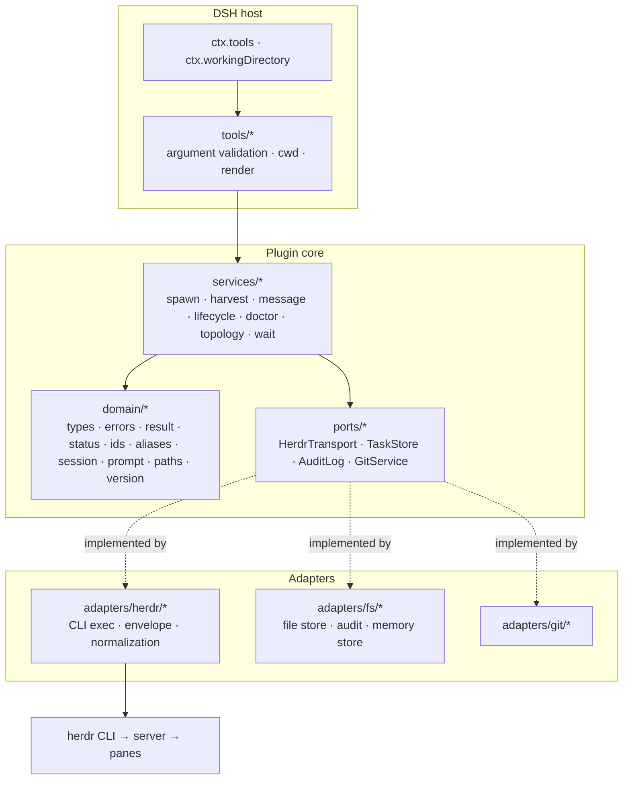

# Architecture

`dsh-herdr` is a DSH plugin that treats Herdr as an **external subagent runtime**. This document explains the layering, the lifecycle, and the invariants a contributor must preserve. It is the long form of [README § Architecture](../README.md#architecture-at-a-glance).

## Goals and non-goals

**Goals**

1. A DSH agent can delegate a self-contained task to a specific kind + model in a Herdr pane, and get back a reviewable result.
2. Results are evidence, not claims: exact final message, git diff, tests, session path.
3. The user keeps the terminal: panes are visible, steerable, and remain after the task.
4. The plugin never touches panes it did not create.
5. The core is host-agnostic: only the tool adapter imports DSH.

**Non-goals (0.1.x)**

- Replacing DSH's in-process subagents or workflow engine.
- Full Herdr layout CRUD (tabs/panes/workspaces beyond the dedicated delegation workspace).
- Auto-merge or worktree orchestration (a future opt-in).
- Multi-machine `herdr --machine` forwarding.
- A GUI panel. The tool cards are the UI for now.

## Layers



**The dependency rule**: `tools → services → ports ← adapters`, with `domain` importable from every layer. No adapter imports a service. No service imports an adapter. No domain module imports DSH. `src/index.ts` is the only composition root.

Consequences:

- services are unit-testable with `MemoryTaskStore` and a fake transport;
- swapping CLI for a socket client touches exactly one adapter;
- a second host (TUI, headless, another agent) only re-implements `tools/`.

## Module map

| Path | Responsibility |
|---|---|
| `src/index.ts` | Composition root: config → adapters → services → tools. |
| `src/config.ts`, `src/defaults.ts` | Schemastery schema for the loader; pure defaults/merge for tests. |
| `src/host.ts` | The narrow DSH surface (`ctx`, `exec`, logger). No behavior. |
| `src/domain/types.ts` | `TaskRecord`, `AgentResult`, `AgentInfo`, diff/usage types. |
| `src/domain/errors.ts` | Stable error codes + remediation; `toToolError`. |
| `src/domain/status.ts` | `active` / `settled` / `nextAction` predicates. |
| `src/domain/ids.ts` | Clock/id ports, Herdr agent-name rules. |
| `src/domain/prompt.ts` | Task envelope, agent-message envelope, review findings. |
| `src/domain/result-md.ts` | `result.md` frontmatter parser. |
| `src/domain/session.ts` | pi session JSONL parsing and exact final-message extraction. |
| `src/domain/aliases.ts` | `model-aliases.md` parsing and alias resolution. |
| `src/domain/launch.ts` | Per-kind launch caps and argv. |
| `src/domain/version.ts` | Herdr version parse and hard floor. |
| `src/domain/paths.ts` | `~` expansion, state/task paths, workspace label. |
| `src/ports/transport.ts` | The outbound Herdr contract. |
| `src/ports/store.ts` | Task store, audit, git contracts. |
| `src/adapters/herdr/cli.ts` | Spawn, timeout, abort, envelope, error mapping. |
| `src/adapters/herdr/transport.ts` | Response shapes → domain operations. |
| `src/adapters/fs/store.ts` | Atomic, locked, versioned state file; rotating audit. |
| `src/adapters/fs/memory-store.ts` | Test/embed store. |
| `src/adapters/git/local.ts` | Baseline and bounded diff. |
| `src/services/*` | Use cases. No I/O beyond their ports. |
| `src/tools/*` | Parameter schemas, cwd resolution, model-facing rendering. |

## Spawn lifecycle

```mermaid
sequenceDiagram
  participant D as DSH agent
  participant T as herdr_spawn_agent
  participant S as SpawnService
  participant Store as TaskStore
  participant Topo as TopologyService
  participant H as Herdr CLI
  participant Har as HarvestService

  D->>T: prompt, kind, model, cwd
  T->>S: spawn(input)
  S->>S: gates (enabled, cwd allowlist, concurrency)
  S->>S: resolve alias → model/thinking; build argv
  S->>Store: put(record: starting)
  S->>Topo: ensurePane(cwd)
  Topo->>H: workspace list/create, tab create
  Topo-->>S: paneId, tabId
  S->>H: agent start --kind --pane -- argv
  S->>H: agent get (boot poll → idle/blocked)
  S->>H: agent prompt --wait --until idle/done/blocked
  alt blocked
    S->>Har: harvest(blocked)
    Har-->>D: status=blocked + question
  else timeout
    Har-->>D: status=running + next action
  else settled
    S->>Har: harvest()
    Har->>H: agent get
    Har->>Har: session JSONL / result.md / pane tail
    Har->>Har: git diff since baseline
    Har-->>D: AgentResult
  end
  S->>Store: update(status, sessionPath, settledAt)
```

### Timeout and abort semantics

- A **timeout is not a failure**. The pane and agent stay alive; the result says `status=running`, `nextAction=wait`, and `herdr_get_agent_result(wait:true)` resumes waiting. Re-submitting the prompt is forbidden by the tool description and would be a bug.
- **Abort** (`exec.signal`) sends Escape to an owned agent and records `interrupted`. It never kills the pane.
- **Stall** (`agent_prompt_stalled`) is retried once after 2s. A second stall returns `AGENT_STALLED` with the pane id; the record stays `failed` for inspection.

## State model

Two state machines are intentionally separate.

| Herdr `agent_status` | Meaning | Our `TaskStatus` after harvest |
|---|---|---|
| `working` | provider turn running | `running` |
| `blocked` | approval/question UI | `blocked` |
| `idle` / `done` | ready for input | `completed` (fresh message) / `idle` (external observation) |
| `unknown` | recognized but unclassifiable | `running` |
| (agent gone) | pane closed | `gone` |

`TaskStatus` also has `starting`, `failed`, `closed`, `interrupted`. `isActiveStatus` decides the concurrency slot; `isSettledStatus` decides whether `herdr_get_agent_result` should wait.

### Freshness

A pi session file is append-only across turns. Harvest only accepts its last assistant message when `session.mtime >= promptedAt - 1s`. Otherwise the message belongs to an earlier turn and is ignored; the fallback artifacts take over. This is what makes a **follow-up** message safe on the same session file.

## Persistence

```
~/.dsh/herdr/
├── state.json          # schemaVersion 1, tasks + workspace map
├── state.json.lock     # advisory cross-process lock
├── audit.ndjson        # append-only events, rotates at 5 MB
└── tasks/<taskId>/
    ├── prompt.md       # the exact envelope sent
    ├── result.md       # written by the child
    ├── diff.patch      # baseline..harvest, bounded
    └── inbox.ndjson    # child → DSH messages (reserved)
```

- Writes are atomic (`tmp` + `rename`).
- A cross-process lock (create-exclusive file with PID/timestamp, 15s stale) prevents two DSH processes from losing an update.
- A corrupt state file is renamed to `state.json.corrupt-<ts>` and the registry starts empty; losing the registry is recoverable, refusing to start is not.
- Nothing is written into the project checkout.

## Invariants

1. **One source of truth per fact.** Herdr owns pane/agent state; our store owns task intent and artifact paths; the child's session owns its words.
2. **Ownership before mutation.** `close`/`interrupt` require a registry record and refuse when the live pane no longer matches the record.
3. **A record exists before a pane.** A crash between the two leaves an inspectable `starting` record, not an orphan.
4. **No silent approval.** `blocked` is a result, never an action.
5. **Bounded evidence.** Result text and patches are truncated by config; the full files remain on disk with a path in the result.
6. **Host boundary is narrow.** Only `src/index.ts`, `src/tools/*`, and `src/types/dsh.d.ts` know DSH exists.
7. **Aliases are policy.** Model resolution reads the user's table; the plugin never invents a provider mapping.

## Extension points

| Want to… | Implement / change |
|---|---|
| Support a socket/SSH transport | `src/ports/transport.ts` + a new adapter; wire in `index.ts` |
| Persist tasks elsewhere | `src/ports/store.ts` (SQLite, remote) |
| Add a kind with native model flags | `src/domain/launch.ts` `kindCaps` + `buildAgentArgs`, with a test |
| Change the review packet | `AgentResult` + `docs/result-contract.md` + renderer test |
| Add a UI panel | A client plugin consuming the same `AgentResult`; no core change |

## Why not MCP or a native subagent provider?

- **MCP** could expose the same verbs, but loses `exec.signal`, the session cwd, tool cards, and the profile config. It remains a reasonable portability path; the domain/services split makes it a new adapter, not a rewrite.
- **Native subagent provider** (`ctx.subagents`) would give in-process cards and cancellation, but requires implementing DSH's provider/session-projection interfaces, which are still moving in the `0.2.x` rc line. The tool surface is the stable contract today; a provider can wrap these services later.
