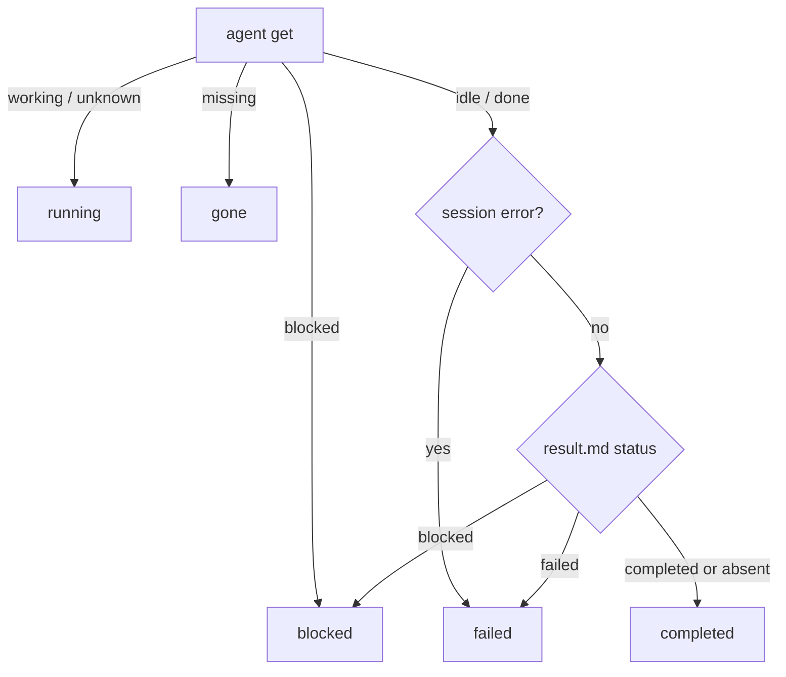

# Result contract

Every delegation resolves to one `AgentResult` object (`schemaVersion: 1`). The JSON Schema lives at [`schema/agent-result.schema.json`](../schema/agent-result.schema.json); this page explains the semantics the schema cannot.

## Shape

```jsonc
{
  "schemaVersion": 1,
  "taskId": "tmg3k2a1b2c3",
  "status": "completed",
  "role": "worker",
  "agent": {
    "name": "worker-flash-a1b2",
    "paneId": "wV:p9",
    "tabId": "wV:t4",
    "workspaceId": "wV",
    "kind": "pi",
    "model": "commandcode/deepseek/deepseek-v4.1-flash",
    "thinking": "high"
  },
  "herdrStatus": "idle",
  "sessionPath": "/Users/me/.pi/agent/sessions/.../x.jsonl",
  "summary": "added retry with jitter",
  "finalMessage": "…the exact last assistant message…",
  "result": {
    "path": "/Users/me/.dsh/herdr/tasks/tmg3k2a1b2c3/result.md",
    "text": "…body…",
    "meta": {
      "status": "completed",
      "summary": "added retry with jitter",
      "tests": "npm test (42 passed)",
      "files": "src/http.ts, src/http.test.ts"
    }
  },
  "diff": {
    "baselineHead": "…",
    "stat": " 2 files changed, 40 insertions(+), 7 deletions(-)",
    "files": ["src/http.ts", "src/http.test.ts"],
    "untracked": [],
    "patchPath": "/Users/me/.dsh/herdr/tasks/tmg3k2a1b2c3/diff.patch",
    "patchBytes": 3210,
    "truncated": false,
    "dirtyAtStart": []
  },
  "tests": "npm test (42 passed)",
  "files": ["src/http.ts", "src/http.test.ts"],
  "usage": { "assistant": 3, "toolCalls": 12, "outputTokens": 4800 },
  "timing": { "createdAt": 1760000000000, "promptedAt": 1760000000500, "settledAt": 1760000042000, "elapsedMs": 42000 },
  "nextAction": "none"
}
```

## Field semantics

| Field | Meaning |
|---|---|
| `status` | Our lifecycle: `starting · working · blocked · idle · running · completed · failed · gone · closed · interrupted`. |
| `herdrStatus` | Herdr's raw state at harvest: `idle · working · blocked · done · unknown`. |
| `role` | `worker` or `reviewer`. |
| `summary` | `result.md` summary → first line of the final message → first body line → a status sentence. |
| `finalMessage` | pi: the exact last assistant message **only if** the session file changed after `promptedAt`. |
| `result.text` | `result.md` body, or the final message when no artifact exists. |
| `result.meta` | The four frontmatter keys; unknown keys are ignored. |
| `diff.baselineHead` | The commit recorded at spawn. `git diff <head>` includes committed and working-tree changes. |
| `diff.dirtyAtStart` | Porcelain lines that already existed at spawn; subtract them when blaming the child. |
| `usage` | Recovered from pi assistant messages (`output` tokens + `toolCall` blocks). |
| `nextAction` | `none` (done), `wait` (running), `answer` (blocked), `inspect` (failed/gone/interrupted). |
| `warnings` | Honest caveats: stale session, empty harvest, reviewer changed files. |

## Status derivation



For an **external** record (a pane the plugin did not spawn), the derivation is observational only: `idle/done → idle`, `working → running`, `blocked → blocked`, missing → `gone`. Its last message is context, not a verdict.

## Versioning

- `schemaVersion` is an integer. Additive fields do not bump it; a removed field or a changed meaning does.
- A bump is a **minor** package version when old readers keep working (additive), and a **major** when they do not.
- `docs/result-contract.md` and `schema/agent-result.schema.json` change in the same commit as the type.

## Why these fields

- **`sessionPath`** lets DSH inspect the full transcript instead of trusting a summary.
- **`diff.patch`** is the reviewer's primary evidence; a child's prose is secondary.
- **`timing`** exposes slow starts vs slow turns without a separate metrics system.
- **`nextAction`** encodes the required behavior (`wait`, don't resubmit; `answer`, ask the human) so a model does not have to infer it from free text.
