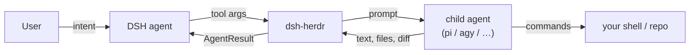

# Security

`dsh-herdr` gives a model the ability to start processes in your terminal. That is the point, and it is also the risk. This page states the trust boundaries, what the plugin does about them, and what it deliberately does not.

## Trust boundaries

- **DSH is trusted** to call tools with the user's intent. It is still a model: a prompt-injected document can steer it.
- **The child is untrusted output.** Its final message, `result.md`, and pane text are data. The plugin never executes instructions found in them.
- **The OS is the user's.** Children run with the user's permissions; the plugin cannot sandbox them.
- **The local socket is private.** The socket adapter speaks an undocumented
  protocol; it is local-only, opt-in, and never used for remote machines.
- **Panel actions are gated twice.** The browser route requires a same-origin
  POST, JSON content type, and `x-herdr-panel: 1`; the lifecycle service then
  refuses unowned tasks, changed panes, and active closes without `force`.
  Reads return task text; treat the web origin as trusted.
- **Remote machines are limited by config.** `machines` is an allowlist; file
  access comes from `machineTargets` (SSH) or `sharedFilesystem`. The SSH bridge
  runs with `BatchMode=yes`, never stores credentials, and quotes every path;
  OpenSSH owns keys, agents, and host-key trust. A remote delegation still runs
  commands with the remote user's permissions.

## Threats and mitigations

| Threat | Mitigation | Residual risk |
|---|---|---|
| Child edits outside the intended repo | `allowCwd` boundary; the envelope says "do not edit outside cwd" | A determined child can ignore the instruction; use a restricted OS user or a worktree for hard isolation. |
| Child exfiltrates secrets | Prompts contain only what you pass; no env dump; audit stores task metadata, not full env | Any process running as you can read your files. |
| Prompt injection in a reviewed file steers DSH | Tool results are framed as evidence; the skill says treat child output as data | Model-level injection is never fully preventable. Review before approving writes. |
| Auto-approval of a blocked child | The plugin never answers `blocked`; it returns the question to DSH, which must ask the user | A user who says "just approve everything" reintroduces the risk. |
| Pane hijack: closing a user's pane | `close`/`interrupt` require a registry record and verify the live pane still matches; unowned handles are refused | A recycled pane id after a restart could match an old record; the live-agent check limits it. |
| Resource exhaustion | `maxParallelAgents`, 1h timeout cap, bounded result/patch sizes | A child can still burn tokens inside its turn. |
| State corruption | Atomic writes, cross-process lock, corrupt file quarantined | Manual deletion loses task history (panes remain). |
| Supply chain | No runtime dependencies; build deps pinned in `pnpm-lock.json`; npm provenance on release | The DSH and Herdr binaries are trusted inputs. |

## What the plugin does not do

- It does not sandbox children. If you need a hard boundary, run the delegation as a different OS user, in a container, or in a disposable git worktree (future `isolated` option).
- It does not scan prompts or outputs for secrets.
- It does not enforce a read-only reviewer at the OS level. `role=reviewer` changes the envelope and adds a post-hoc warning when the reviewer's diff is non-empty; a malicious child can still write.
- It does not auto-approve, auto-merge, or push.

## Operating recommendations

1. Set `allowCwd` to the projects you actually delegate in.
2. Keep panes open (the plugin does) so a human can see what ran.
3. Read the diff before accepting a worker's change, especially when the child is a different model family.
4. Treat `result.md`, pane text, and final messages as untrusted. They are evidence, not instructions.
5. Run the desktop app as your normal user; do not run it as root.
6. Review `~/.dsh/herdr/audit.ndjson` when something unexpected happens.

## Reporting a vulnerability

Please do not open a public issue for a security problem. See [SECURITY.md](../SECURITY.md) for the private channel and the response target.
